


<a href="https://github.com/saimaheswar/streamguard">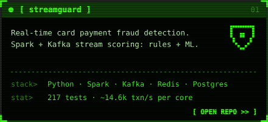</a>
<a href="https://github.com/saimaheswar/migrateledger">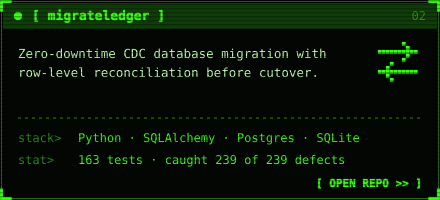</a>
<a href="https://github.com/saimaheswar/lakeforge">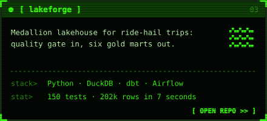</a>
<a href="https://github.com/saimaheswar/mailsift">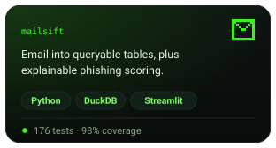</a>
<a href="https://github.com/saimaheswar/portfolio">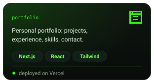</a>
<a href="https://github.com/saimaheswar/bike-rental-project">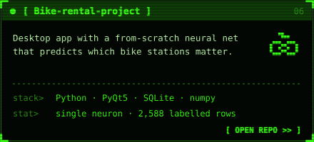</a>
<a href="https://github.com/saimaheswar/NERV">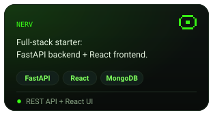</a>
<a href="https://github.com/saimaheswar/finance-dashboard">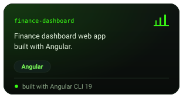</a>
<a href="https://github.com/saimaheswar/ecommerce-security-project">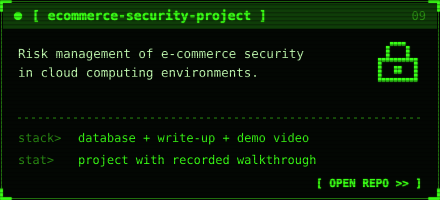</a>
<a href="https://github.com/saimaheswar/v0-pay-window-tracker-app">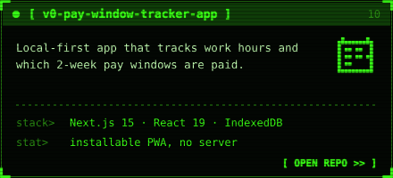</a>
<a href="https://github.com/saimaheswar/PYTHON1">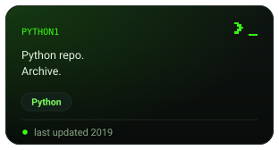</a>
<a href="https://github.com/saimaheswar/gitam-june-2019">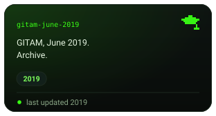</a>

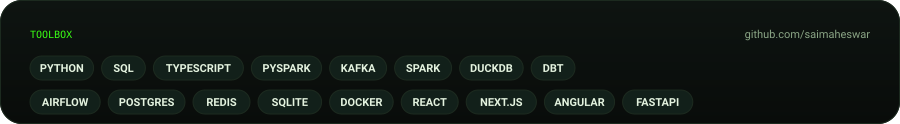

