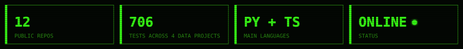
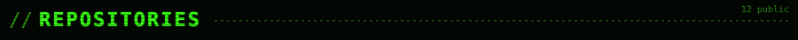
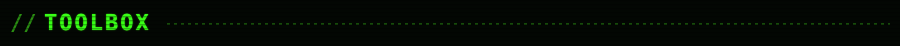
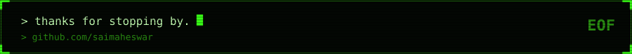

<table>
<tr><td width="50%" align="center"></td><td width="50%" align="center"></td></tr>
<tr><td width="50%" align="center"></td><td width="50%" align="center"></td></tr>
<tr><td width="50%" align="center"></td><td width="50%" align="center"></td></tr>
<tr><td width="50%" align="center"></td><td width="50%" align="center"></td></tr>
<tr><td width="50%" align="center"></td><td width="50%" align="center"></td></tr>
<tr><td width="50%" align="center"></td><td width="50%" align="center"></td></tr>
</table>

